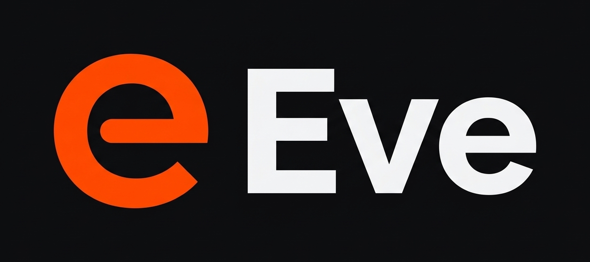

# Eve

Experimental open-source Nintendo Switch 2 emulator for Windows, Linux and macOS.

Eve is a fork of [Lichii](https://github.com/Frizti/Fritchii) (`oot-gather-fix`), based on [Eglantine](https://github.com/Djihads80/Eglantine), Eden and yuzu. Licensed under GPL-3.0-or-later; see `LICENSE.txt` and `LICENSES/`.

## Switch 2 Engine Optimizations in Eve

- **Host-RAM-Aware Pipeline Cache Budget (`nx2_pipeline_budget.h`)**: Caps live `VkPipeline` retention (`2,500` on <= 16 GiB RAM, `5,000` on 24 GiB, `8,000` on 32 GiB+) and frees `FileEnvironment` shader buffers immediately after warming the driver cache, eliminating >10 GiB swapfile thrashing on 16 GiB hosts.
- **CCX-Friendly Shader Prebuild Threading**: Restricts background `VkPipelinePrebuild` to 1 worker on <= 12-thread CPUs (e.g. 6C/12T Zen 2 APUs) so guest Dynarmic cores and split GPU threads never starve.
- **Automatic BC1 ASTC Recompression on < 6 GiB VRAM GPUs**: Halves texture VRAM and bandwidth (4 bpp vs BC3 8 bpp) on 4 GB / 6 GB cards, eliminating the texture-cache eviction loop (~50 ASTC GPU decodes/s).
- **Dynamic Resolution Controller Preservation (`0400486024DEC000`)**: Keeps Ocarina of Time's GPU-time dynamic resolution controller active in Handheld mode (`EDEN_NX2_OOT_MAX_RES=1` forces max resolution).
- **Ranged `MaxwellDMA` Split-GPU Tracking**: Mirrors `MaxwellDMA` state on the split front thread to record exact pitch copy ranges (`NoteMemoryWrite`) instead of invalidating all `dma_snapshots` globally.
- **Desktop Vulkan Submission Batching & Async SPIR-V**: Enables 4,096-draw desktop submission budgets (`SubmitBudget`), `IndexRebind` deduplication, worker-thread graphics SPIR-V emission (`AsyncPipelines`), and `FrontSleep` backoff by default.

## Builds

| Asset | Target |
|---|---|
| `eve-windows-x86_64-zen2-pgo.zip` | Clang + PGO (`eglantine.profdata`) + `-march=znver2` (AMD Ryzen 3000/4000/5000+) |
| `eve-windows-x86_64-pgo.zip` | Clang + PGO (`eglantine.profdata`), generic x86-64 |
| `eve-windows-x86_64.zip` | MSVC x86-64 |

You need your own console dump (keys, firmware and games). Eve does not ship any Nintendo files.
